# Отчёт по лабораторной работе № 2

## Исследование Google Cloud Run

**Выполнил:** Новиков А. А.  
**Группа:** U4225 
**Дата выполнения:** 8 ноября 2026 г.

## 1. Цель работы

Развернуть контейнеризованное приложение в Google Cloud Run, проверить его доступность по HTTPS, изучить журналы и метрики, изменить порт контейнера и распределить трафик между ревизиями.

## 2. Теоретическая справка

Cloud Run — управляемая платформа для запуска контейнеров. Она масштабирует количество экземпляров сервиса в зависимости от нагрузки. При минимальном числе экземпляров, равном нулю, сервис может масштабироваться до нуля. В работе использовался режим тарификации **Request-based**.

При изменении конфигурации сервис получает новую ревизию. На вкладке **Revision History** можно увидеть созданные ревизии и настроить доли трафика. Журналы и метрики доступны на вкладке **Observability**.

Cloud Run передаёт настроенный порт входному контейнеру через переменную окружения `PORT`. Приложение должно принимать запросы на этом порту. [Документация по настройке Cloud Run](https://docs.cloud.google.com/run/docs/configuring#container)

## 3. Ход работы

### 3.1. Развёртывание сервиса

В проекте `cloud-platforms-as-the-basis` через Google Cloud Console был развёрнут демонстрационный контейнер.

| Параметр | Значение |
| --- | --- |
| Сервис | `novikov-hello-lab2` |
| Регион | `europe-west3` (Франкфурт) |
| Образ | `us-docker.pkg.dev/cloudrun/container/hello` |
| Лимит CPU | 0,08 vCPU (80 millicores) |
| Лимит памяти | 128 MiB |
| Тарификация | Request-based |
| Минимум / максимум экземпляров | 0 / 1 |
| Начальный порт контейнера | 8080 |
| Параллельных запросов на экземпляр | 1 |
| Тайм-аут запроса | 300 с |
| Доступ | Без аутентификации |

Консоль показала завершение создания сервиса, первой ревизии и настройки маршрутизации. Ревизия `novikov-hello-lab2-00001-cdp` получила 100% трафика.

*Скриншот 1. Первая ревизия и начальное распределение трафика*

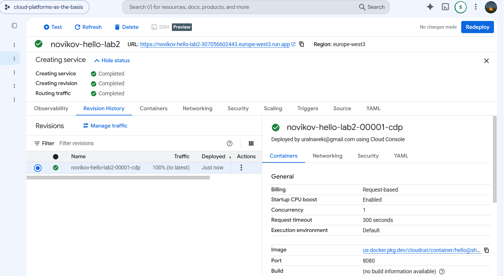

*Скриншот 2. Лимиты CPU и памяти, образ и порт 8080*

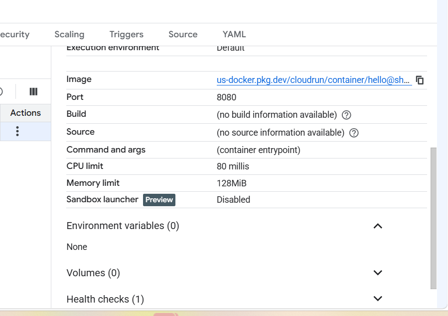

### 3.2. Проверка доступности сервиса

В браузере был открыт публичный адрес сервиса:

```text
https://novikov-hello-lab2-307056602443.europe-west3.run.app
```

Загрузилась демонстрационная страница **It's running!**. На странице указаны сервис, регион и идентификатор первой ревизии. В журнале обращение к корневому пути зафиксировано как `GET /` с ответом `200 OK`.

*Скриншот 3. Страница It's running! после первого развёртывания*

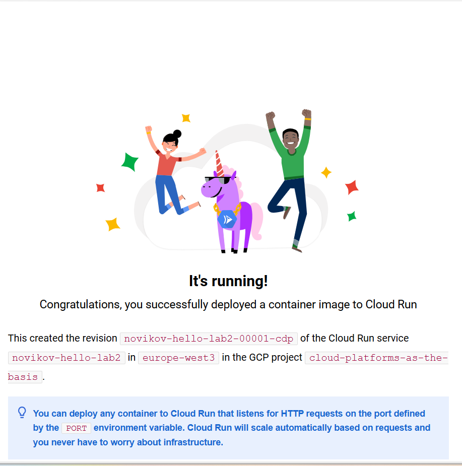

### 3.3. Анализ журналов и метрик

В **Observability → Logs** зафиксированы создание сервиса, запуск контейнера, успешная стартовая TCP-проверка на порту `8080` и переход сервиса в состояние готовности. Запросы страницы и её ресурсов вернули `200 OK`. В показанных записях длительность отдельных запросов составила от 3 до 29 мс.

*Скриншот 4. Журнал первого запуска и успешных HTTP-запросов*

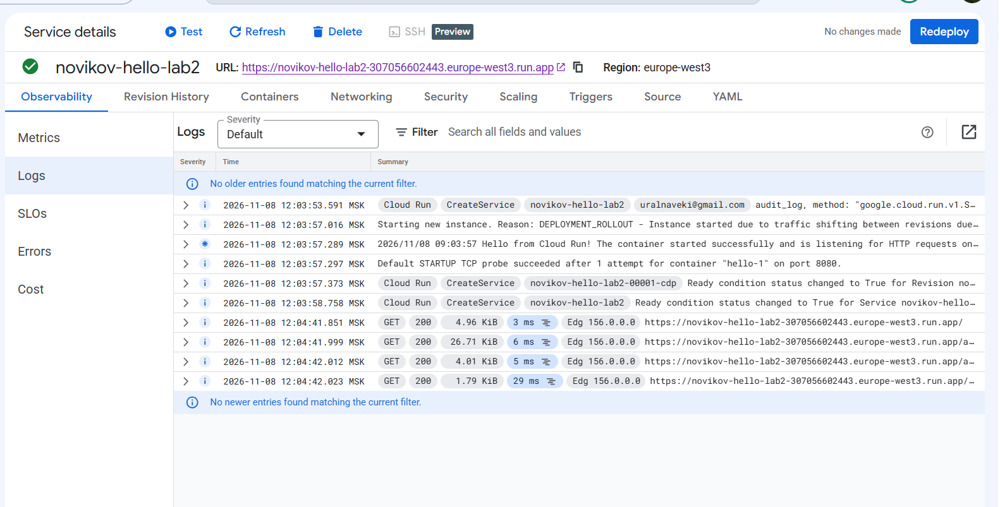

В **Observability → Metrics** были изучены графики запросов, задержек, количества экземпляров, загрузки CPU и использования памяти. На графике **Container startup latency** за выбранный интервал данных не было.

*Скриншот 5. Частота запросов и задержки ответа*

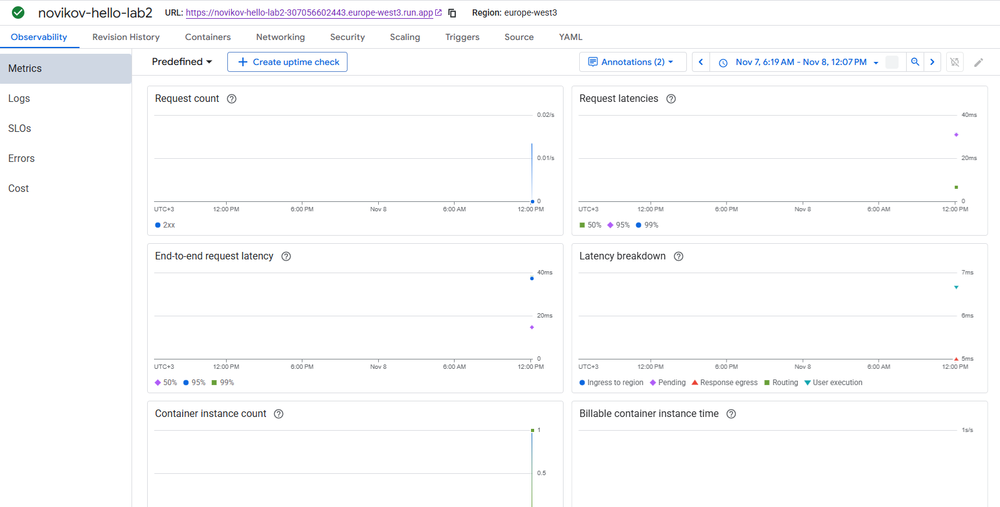

*Скриншот 6. Количество экземпляров и использование CPU и памяти*

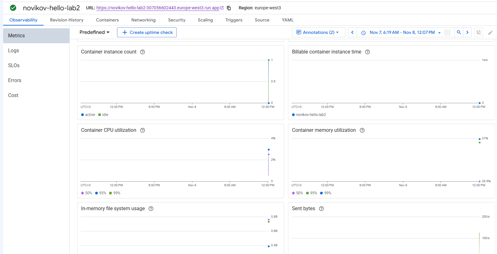

*Скриншот 7. Панели задержки запуска, проверок состояния и рекомендуемого числа экземпляров*

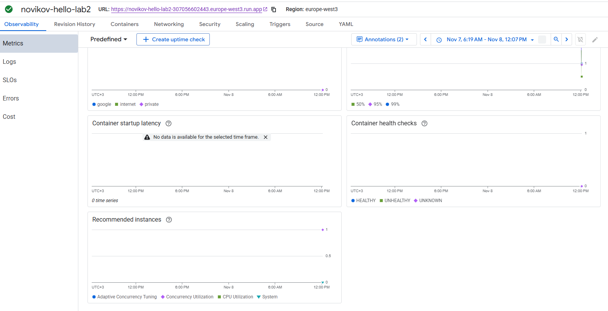

### 3.4. Изменение порта контейнера на 8090

В настройках контейнера порт был изменён с `8080` на `8090`. На этапе обновления консоль отметила создание ревизии и настройку маршрутизации как **Completed**. По результатам проверки, описанной в исходном отчёте, страница продолжила открываться по прежнему публичному адресу.

*Скриншот 8. Настройка порта 8090 и завершённое обновление сервиса*

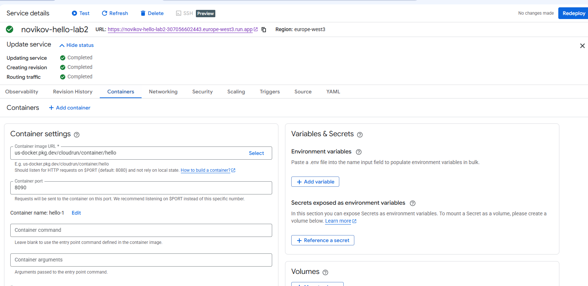

*Скриншот 9. Настройки контейнера с портом 8090 после обновления*

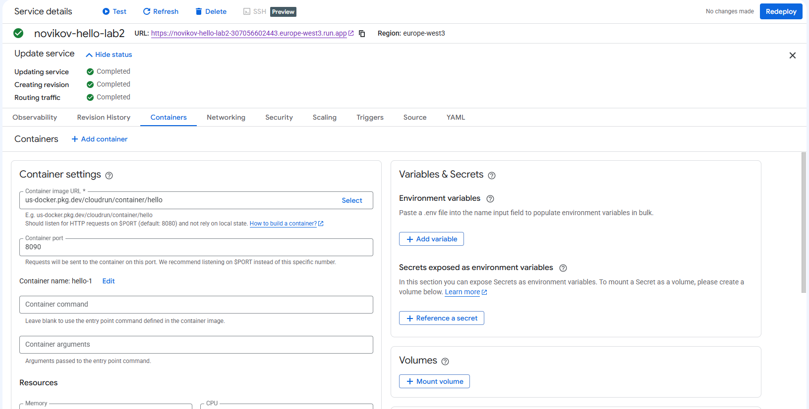

Результат согласуется с контрактом Cloud Run: платформа передаёт контейнеру настроенное значение через `PORT` и направляет запросы на этот внутренний порт. Публичный HTTPS-адрес сервиса сохраняется.

### 3.5. Распределение трафика между ревизиями

После повторных развёртываний трафик настроили через **Revision History → Manage traffic**. Итоговое распределение видно в списке ревизий.

| Ревизия | Доля трафика |
| --- | ---: |
| `novikov-hello-lab2-00004-zgr` | 50% |
| `novikov-hello-lab2-00003-sh4` | 50% |
| `novikov-hello-lab2-00002-96f` | 0% |
| `novikov-hello-lab2-00001-cdp` | 0% |

*Скриншот 10. Итоговое распределение трафика 50/50 между ревизиями 00004 и 00003*

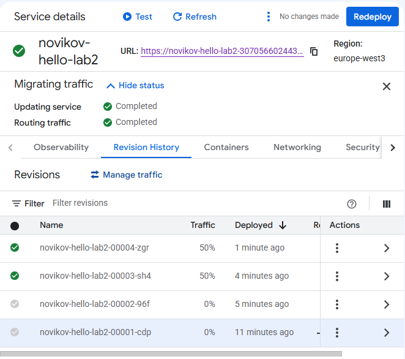

В журнале видны запуск экземпляров и переход ревизий в состояние готовности. Итоговые доли подтверждает таблица **Revision History**. Приложенный фрагмент журнала не позволяет измерить фактическую долю запросов для каждой из двух ревизий.

*Скриншот 11. Журнал запуска контейнеров и обновления сервиса*

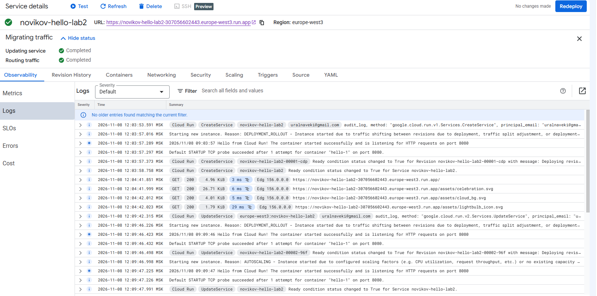

### 3.6. Удаление сервиса

После завершения экспериментов сервис `novikov-hello-lab2` был удалён. Cloud Run показал уведомление **Service deleted** и пустой список сервисов проекта.

*Скриншот 12. Список сервисов Cloud Run после удаления*

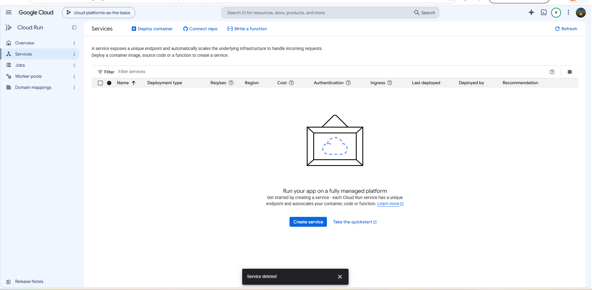

## 4. Выводы

В ходе работы был развёрнут и проверен по HTTPS демонстрационный сервис Cloud Run с лимитами 0,08 vCPU и 128 MiB памяти. Журналы подтвердили успешный запуск контейнера и ответы `200 OK`, а метрики показали активность сервиса и потребление ресурсов. Обновление порта до `8090` завершилось успешно. В консоли было подтверждено распределение трафика поровну между двумя последними ревизиями. После завершения работы сервис удалили.

**Дата сдачи:** 8 ноября 2026 г.  
**Подпись:** ____________________
