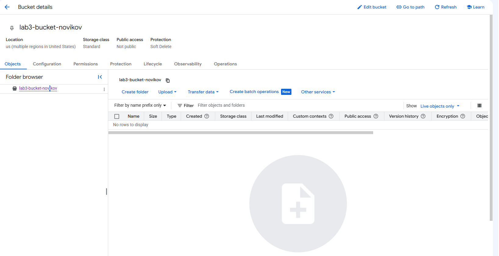
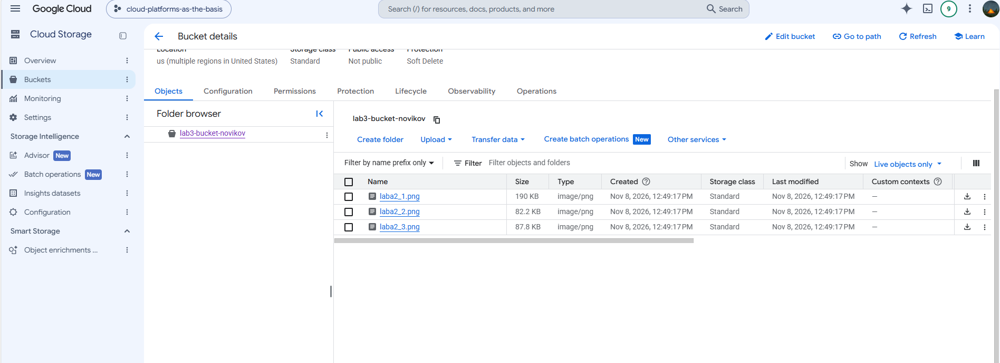
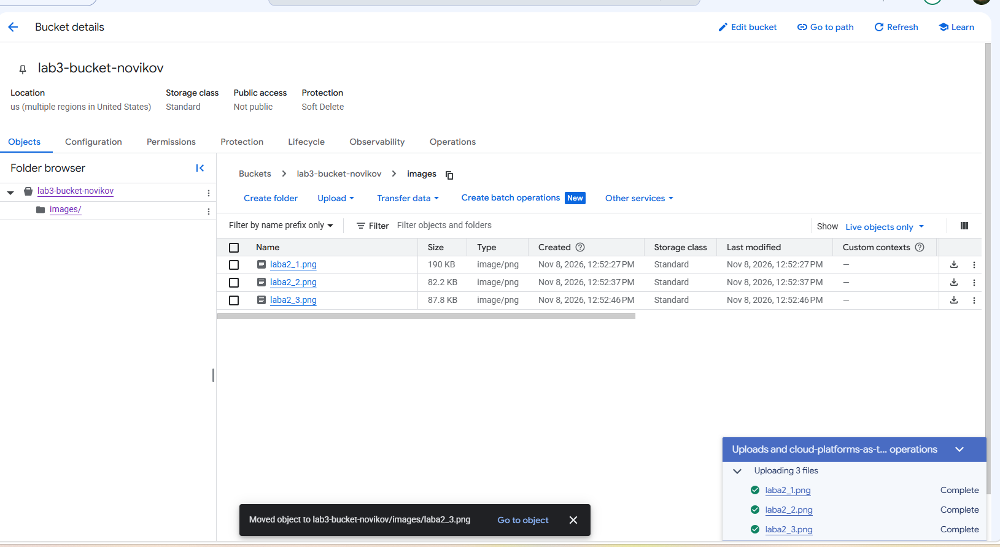
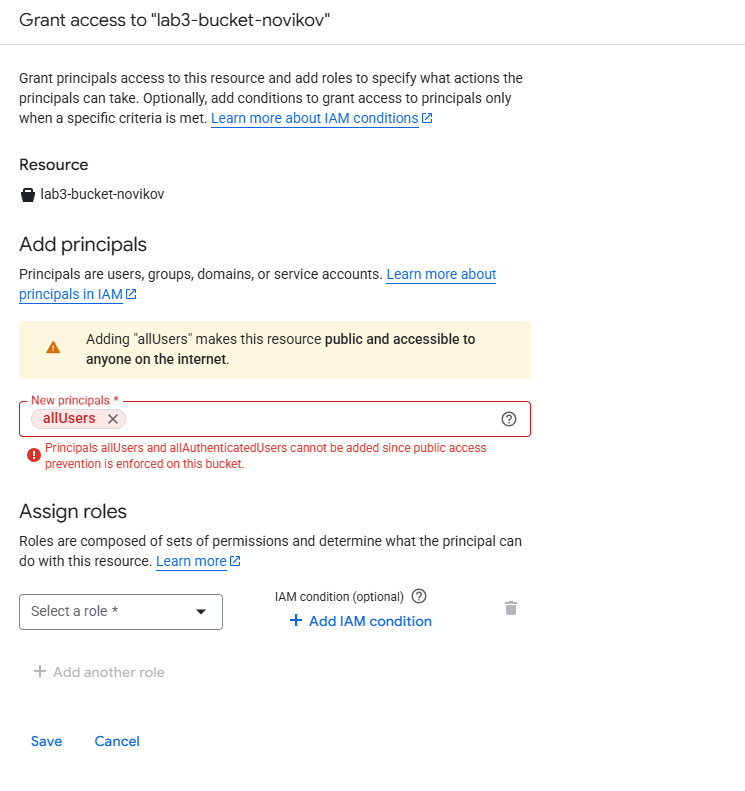
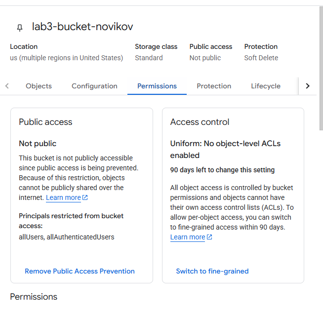
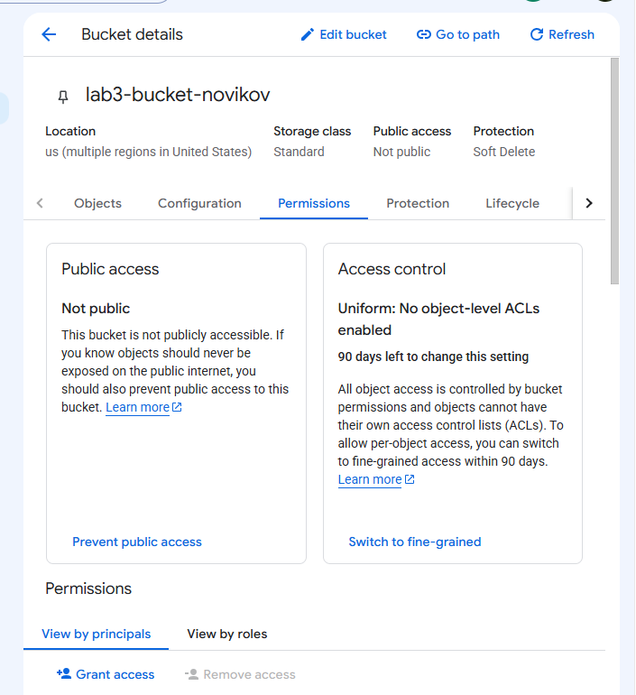
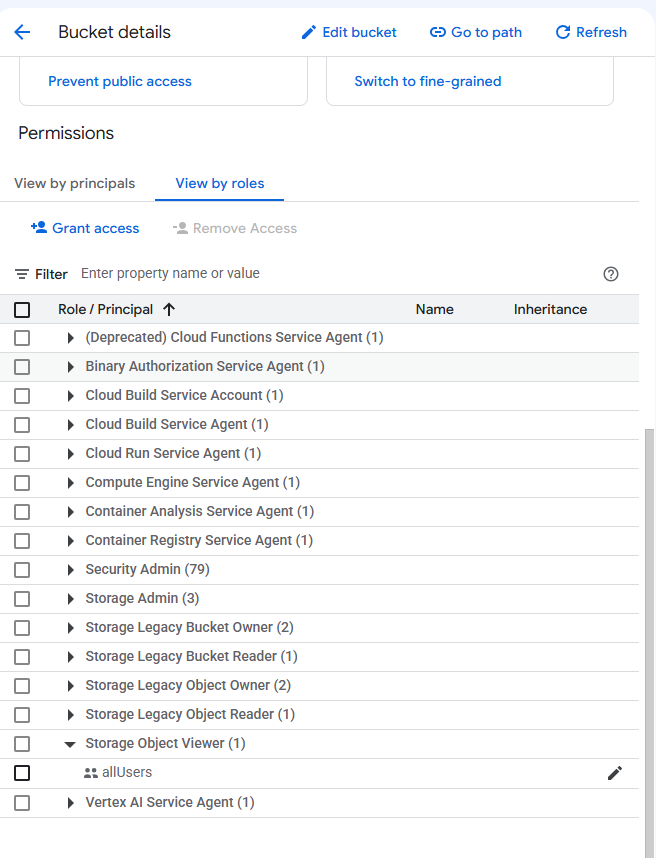
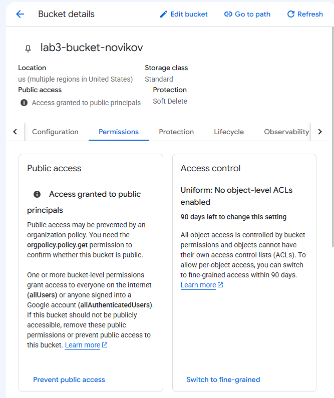
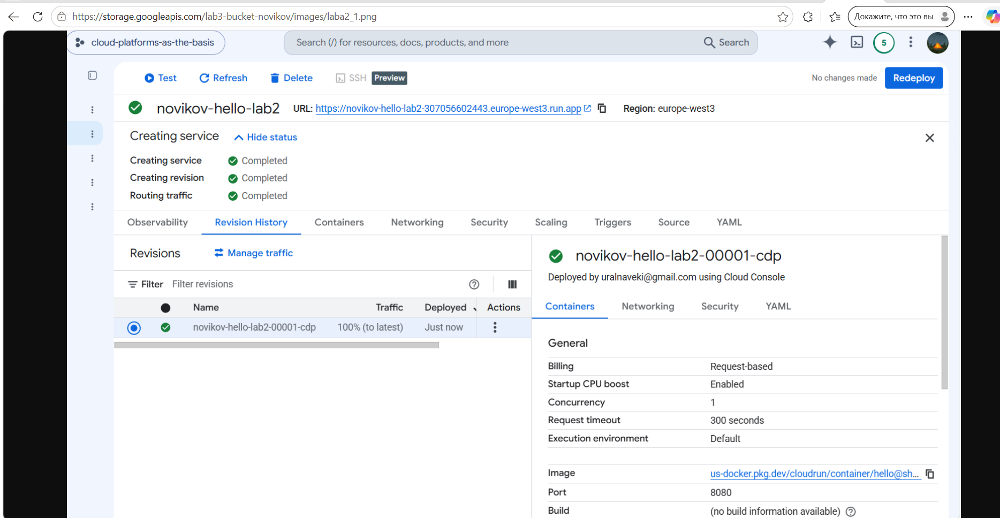
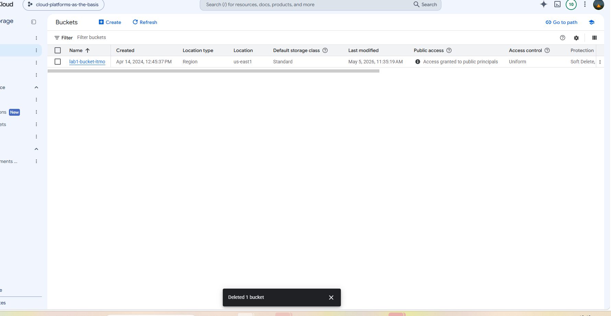

# Отчёт по лабораторной работе № 3

## Исследование Google Cloud Storage

**Выполнил:** Новиков А. А.  
**Группа:** U4225 
**Дата выполнения:** 8 ноября 2026 г.

## 1. Цель работы

Изучить объектное хранилище Google Cloud Storage. Создать бакет, загрузить и переместить изображения, настроить публичное чтение, проверить доступ по HTTPS и удалить созданный ресурс.

## 2. Теоретическая справка

Cloud Storage хранит данные в бакетах. Объект состоит из содержимого и метаданных и имеет имя в пределах бакета. В бакетах с плоским пространством имён консоль отображает общие префиксы объектов как папки. Например, у объекта `images/laba2_1.png` префикс — `images/`.

| Модель хранения | Как организованы данные | Типичное применение |
| --- | --- | --- |
| Блочная | Блоки на томе, который ОС видит как диск | Диски ВМ, базы данных |
| Файловая | Файлы и каталоги | Общие файловые ресурсы |
| Объектная | Именованные объекты с метаданными в бакетах | Статический контент, резервные копии, архивы |

## 3. Ход работы

### 3.1. Создание бакета

В проекте `cloud-platforms-as-the-basis` создан бакет со следующими параметрами.

| Параметр | Значение |
| --- | --- |
| Имя бакета | `lab3-bucket-novikov` |
| Расположение | `US`, мультирегион США |
| Класс хранения | Standard |
| Управление доступом | Uniform |
| Защита | Soft Delete |
| Публичный доступ после создания | Not public |



### 3.2. Загрузка изображений

Через вкладку **Objects** в корень бакета загружены три файла PNG из лабораторной работы № 2. Размеры приведены по интерфейсу Cloud Console.

| Объект | Размер |
| --- | ---: |
| `laba2_1.png` | 190 KB |
| `laba2_2.png` | 82,2 KB |
| `laba2_3.png` | 87,8 KB |



### 3.3. Перемещение объектов

В консоли создана папка `images/`, в которую перемещены все три файла. После перемещения объекты отображались под именами `images/laba2_1.png`, `images/laba2_2.png` и `images/laba2_3.png`.



### 3.4. Настройка публичного чтения

При первой попытке добавить `allUsers` консоль выдала ошибку. На бакете действовала настройка **Public Access Prevention**, которая блокировала выдачу публичного доступа. [Документация Google Cloud о Public Access Prevention](https://docs.cloud.google.com/storage/docs/public-access-prevention)





После снятия запрета бакет по-прежнему отображался как **Not public**. Затем на уровне бакета участнику `allUsers` назначена роль **Storage Object Viewer**. Консоль показала, что доступ предоставлен публичным участникам. Режим **Uniform** сохранился.







### 3.5. Проверка доступа по HTTPS

Изображение `images/laba2_1.png` открылось в браузере по прямому адресу. Ниже указан адрес, который использовался до удаления бакета.

```text
https://storage.googleapis.com/lab3-bucket-novikov/images/laba2_1.png
```



### 3.6. Удаление бакета

После проверки бакет `lab3-bucket-novikov` удалён. Консоль показала уведомление **Deleted 1 bucket**, а бакет третьей лабораторной исчез из списка. Учебный бакет `lab1-bucket-itmo` остался в проекте.



## 4. Выводы

В работе проверен полный цикл работы с учебным бакетом: создание, загрузка трёх PNG, перемещение объектов, открытие изображения по HTTPS и удаление бакета. Эксперимент с доступом показал роль двух настроек: Public Access Prevention блокировала добавление `allUsers`, а после снятия запрета публичное чтение было настроено отдельным назначением роли Storage Object Viewer.

